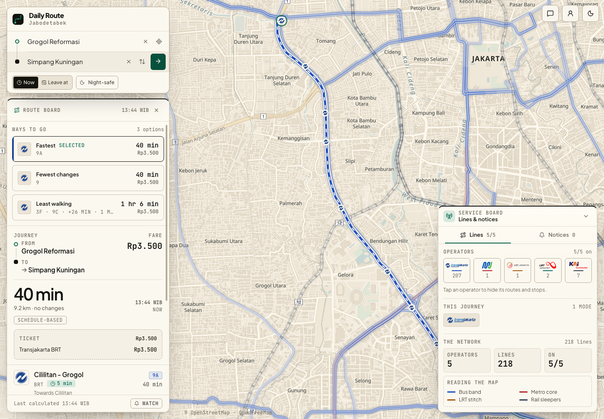
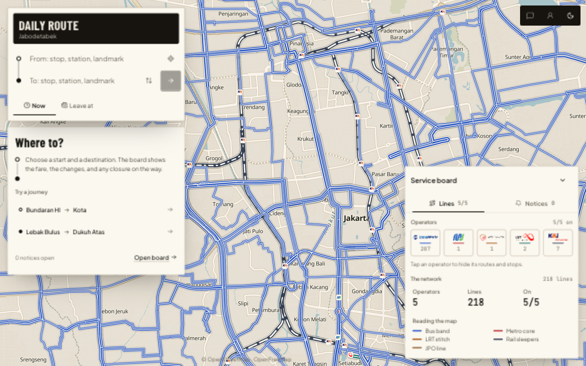
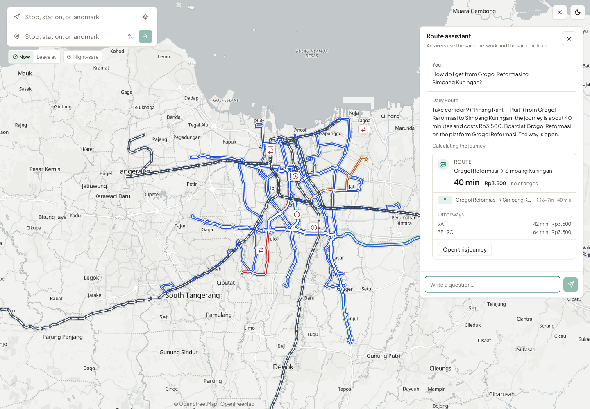
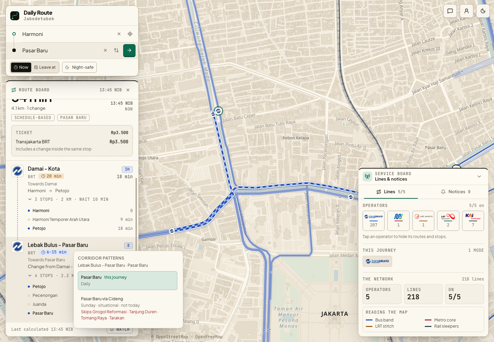
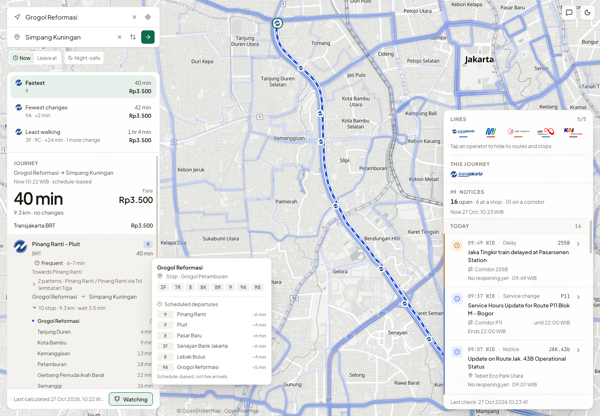
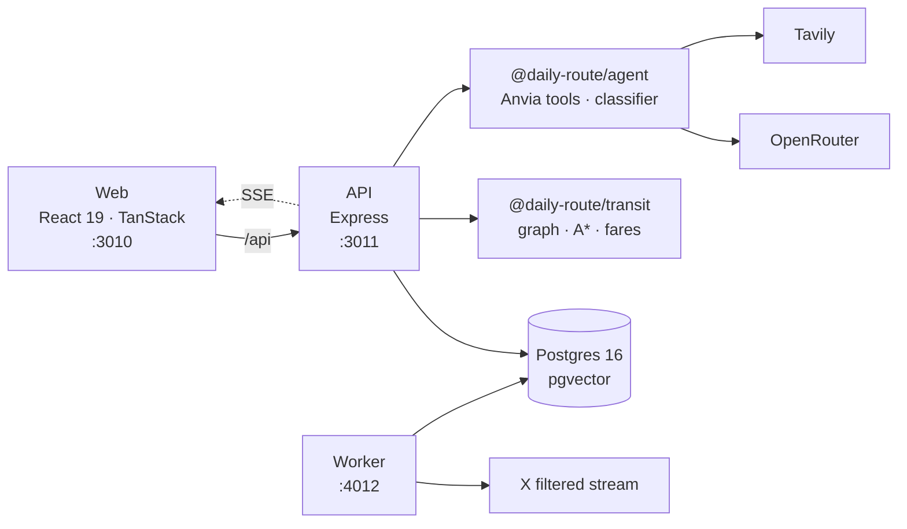

<p align="center">
  
</p>

<h1 align="center">Daily Route</h1>

<p align="center">
  A public-transit route planner and disruption monitor for Greater Jakarta.
</p>

<p align="center">
  <a href="LICENSE"></a>
  <a href="https://github.com/anvia-hq/anvia"></a>
  <a href="https://nodejs.org"></a>
  <a href="https://pnpm.io"></a>
  <a href="https://www.postgresql.org"></a>
</p>

Daily Route answers one question for people in Greater Jakarta: **how do I get
from A to B right now, and is the way still open?** It covers Transjakarta (BRT,
Metrotrans, Royaltrans, Minitrans, Mikrotrans), MRT Jakarta, LRT Jakarta, LRT
Jabodebek and KRL Jabodetabek.

Two halves share the same data. A deterministic A\* planner walks a station
graph and never guesses. An agentic assistant reads the rider's question, calls
the same planner through tools, checks the operators' announcements, and
explains the answer. The agent is never the source of truth about the network.
The graph is.

<p align="center">
  
</p>

## What it does

|                                                                                                                                                                                                                                                                                                                                                                                                |                                                                                                                                                                                                                                                                                                                                                                                                   |
| ---------------------------------------------------------------------------------------------------------------------------------------------------------------------------------------------------------------------------------------------------------------------------------------------------------------------------------------------------------------------------------------------- | ------------------------------------------------------------------------------------------------------------------------------------------------------------------------------------------------------------------------------------------------------------------------------------------------------------------------------------------------------------------------------------------------- |
|  **The way that is still open.** Operator announcements become notices with a scope, a validity window and a source. A closed stop is not a closed corridor: the planner boards or alights at the nearest stop the rider can walk to, and the walk becomes a leg. |  **An assistant that cites the graph.** Ask in plain language. The assistant calls the same tools, then answers with semantic cards for a journey, a stop or a notice. A card cannot contain a station id, fare or duration the tool did not return. |
|  **One code, several patterns.** Koridor 8 runs via Tomang or Cideng; Koridor 9 has all-stop and toll runs. The journey says which pattern it boards, which stops it skips, and whether that pattern runs today.                       |  **A schedule, not an invented ETA.** The stop popover shows the scheduled lines, headsigns and headways. The line windows decide what runs; the planner uses half the median headway as the wait.                                       |

A journey is judged on **time, distance and the number of changes together**,
and the waiting time for a new vehicle is part of it. The planner offers up to
three alternatives with different primary lines, ordered by duration and then by
the number of changes. A gate charges one fare for the whole stay in the paid
area; a reader on the vehicle charges every boarding; a station group is a place
the rider can walk through, not a paid area.

> There is no public GTFS-Realtime vehicle feed for these operators. Every time
> in the interface is a schedule, not a live arrival. The stop popover says so
> in plain language.

## Architecture



| Package             | Responsibility                                                                                                       |
| ------------------- | -------------------------------------------------------------------------------------------------------------------- |
| `apps/web`          | The map-first rider interface. React 19, TanStack Router and Query, Tailwind CSS 4, MapLibre GL.                     |
| `apps/api`          | Express HTTP API: transit reads, route planning, place lookup and agent chat over SSE.                               |
| `apps/worker`       | The background monitor: one X filtered stream, a durable classification queue, notice review and temporary services. |
| `packages/transit`  | Pure domain: station graph, A\* planner, geometry, fares, service windows and text normalisation.                    |
| `packages/semantic` | Embedding providers and the place resolver.                                                                          |
| `packages/agent`    | The Anvia agent, tools, classifier, monitor, X and Tavily clients.                                                   |
| `packages/ingest`   | OpenStreetMap extraction, GTFS, administrative enrichment and the curated/OSM merge.                                 |
| `packages/db`       | Drizzle schema, queries, migrations, seed and snapshot sync.                                                         |
| `packages/env`      | The one place that validates the environment.                                                                        |
| `packages/config`   | Shared TypeScript and ESLint configuration.                                                                          |

| Layer      | Stack                                                                                    |
| ---------- | ---------------------------------------------------------------------------------------- |
| Interface  | React 19, Vite, TanStack Router and Query, Tailwind CSS 4, MapLibre GL                   |
| Service    | Express, Drizzle, PostgreSQL 16, pgvector, `pg_trgm`                                     |
| Agent      | [Anvia](https://github.com/anvia-hq/anvia), OpenRouter, Tavily, Langfuse when configured |
| Monitor    | X API v2 filtered stream, Postgres durable queue, Jev decision model                     |
| Data       | OpenStreetMap, the Transjakarta GTFS feed, the curated research reports                  |
| Repository | pnpm 10 workspaces, Turborepo, Playwright                                                |

## Quick start

You need Node.js 22.16 or newer, pnpm 10.30.3, and Docker.

```bash
pnpm install
cp .env.example .env
pnpm infra:up          # Postgres + pgvector on port 5433
pnpm db:migrate
pnpm db:seed           # loads data/transit-network.json and data/line-patterns.json
pnpm data:embed        # optional: station embeddings
pnpm dev               # API 3011, worker 4012, web 3010
```

Open <http://localhost:3010>.

| Service       | URL                            |
| ------------- | ------------------------------ |
| Web           | <http://localhost:3010>        |
| API           | <http://localhost:3011>        |
| Worker health | <http://localhost:4012/health> |

There is exactly **one** `.env`, at the repository root. Every `pnpm dev` and
`pnpm db:*` script loads it through `dotenv-cli`. Never add a second one inside
a package.

`pnpm data:embed` is optional. Without an embedding model, place lookup uses the
lexical and exact channels and no hash vector is written in their place.

### Configuration

Copy `.env.example` and fill the keys for the parts you want running. The
planner works without any model key; the assistant and the monitor are the parts
that need one.

| Variable                                                                                | What it unlocks                                                                                                                        |
| --------------------------------------------------------------------------------------- | -------------------------------------------------------------------------------------------------------------------------------------- |
| `DATABASE_URL`                                                                          | Postgres 16 + pgvector. The Compose file already sets it.                                                                              |
| `AGENT_BASE_URL`, `AGENT_API_KEY`, `AGENT_MODEL`                                        | The chat and classifier models through an OpenAI-compatible endpoint. Without a key, the assistant is off and the planner still works. |
| `JEV_MODEL`                                                                             | The decision model behind Jev. Defaults to `typesafe/jev-1.14`.                                                                        |
| `EMBEDDINGS_BASE_URL`, `EMBEDDINGS_API_KEY`, `EMBEDDINGS_MODEL`                         | Semantic place lookup. The vector column is 768 dimensions.                                                                            |
| `TAVILY_API_KEY`                                                                        | `search_news` for the assistant, on demand. The monitor does not poll it.                                                              |
| `GOOGLE_MAPS_API_KEY`                                                                   | Optional fallback for the place field. The local Overture extract answers first; only a thin list is sent to Google, and only when this key is set. Without it, that fallback is Photon/Nominatim. |
| `X_BEARER_TOKEN`                                                                        | The operator filtered stream. Billing is per Post read, about $0.005.                                                                  |
| `LANGFUSE_BASE_URL`, `LANGFUSE_PUBLIC_KEY`, `LANGFUSE_SECRET_KEY`                       | Traces for agent runs and evals. Leave them empty to run without telemetry.                                                            |
| `CLASSIFY_BUDGET_MS`, `CLASSIFY_LEASE_MS`, `CLASSIFY_CONCURRENCY`, `NOTICE_SWEEP_LIMIT` | Classification queue budgets, lease time, parallelism and the notice review sweep.                                                     |

Every key stays on the server. Nothing secret reaches the browser, and there is
no `VITE_` prefix in this project.

## The network

`data/transit-network.json` is committed and is the input of the seed. It is
produced by `pnpm data:ingest`, which merges two sources:

- **OpenStreetMap** (ODbL) for coordinates, route relations, stop order and the
  path every vehicle travels;
- **`research/data/*.json`** for the official line names, operators, service
  classes, stop lists, interchange notes and published fares.

The merge rules are deliberate:

1. The curated report owns the **name and the order** of a line's stops.
2. OpenStreetMap owns the **coordinates** and contributes any stop the curated
   list is missing.
3. The OSM relation name wins for the **service class**, because it states the
   brand outright ("Minitrans 1M", "Metrotrans 5F").
4. A station of a line that is not open yet never becomes routable.
5. A station of a different system with a matching name, within 400 m, or with
   an alias the report gives as an interchange, within 1.2 km, is the same place.

The current snapshot carries **256 lines, 5,715 stations, 16,520 stop
sequences, 101 interchange groups, 420 directed geometries and 34 GTFS-derived
patterns**. A line has two directions, and each is its own pattern: its own stop
order and its own path. The planner measures the distance between two stops
along that path, so the time it estimates is the time the vehicle needs, and the
line drawn on the map follows the road.

A route code is not one stop list. Koridor 8 runs via Tomang or via Cideng;
Koridor 9 has all-stop and toll patterns; 7 has toll patterns; L13E is an
express. `line_patterns` (and `data/line-patterns.json`) stores the headsign,
direction, service days, toll flag, ordered stops and shape separately from the
line. The line identity, fare and colour do not change. A Sunday-only pattern is
not "today" unless the tool says so.

### Rebuilding the snapshot

```bash
pnpm data:ingest          # rebuild from OpenStreetMap + research
pnpm data:gtfs            # fill lines with no stops from the operator GTFS
pnpm data:enrich          # name the kelurahan/kecamatan/kota of every stop
pnpm db:sync              # apply the snapshot without clearing the notices
pnpm data:embed           # recompute the station embeddings
pnpm data:places          # rebuild the Jabodetabek place extract from Overture
pnpm db:places            # load the place extract into map_places
```

Run them in that order. `data:ingest` rebuilds the snapshot and drops the GTFS
additions, so `data:gtfs` must follow it; `data:enrich` reads the stations that
`data:gtfs` added. `db:sync` prunes a station, line or group that the snapshot
no longer contains; notices are untouched. A shrinking station count is a red
flag, not a cleanup.

On a fresh database, `pnpm db:seed` replaces `pnpm db:sync`. The seed loads both
the network snapshot and the line patterns.

### Places

`data/places-jabodetabek.parquet` is the Overture Maps places extract for the
Jabodetabek box: 272,964 places with a confidence of at least 0.5, deduplicated
by name within about 110 m. It is open data (CDLA Permissive 2.0, Apache 2.0 for
the Foursquare records); the notices are in `data/PLACES-NOTICE.txt`, and the
release and count are in `data/places-jabodetabek.json`.

```bash
pnpm data:places          # rebuild the extract from the latest Overture release
pnpm db:places            # load it into map_places
```

Both use the DuckDB command line (`brew install duckdb`); the first run
downloads the S3 and Postgres extensions. `db:seed` does not load the places, so
a fresh database needs `pnpm db:places` once. The place field reads
`map_places` first, then falls back to Photon/Nominatim (or Google Places when
`GOOGLE_MAPS_API_KEY` is set) only when the local list holds fewer than three
answers.

## The planner

`packages/transit` is pure TypeScript with no framework and no database. It owns
the graph, the A\* search, the geometry, the fares and the service windows.

- The search cost combines time, distance and the number of changes. The wait
  for a new vehicle is part of the cost, not a fixed five minutes.
- `serviceAt(line, direction, at)` is the one place that answers whether a line
  runs at an instant. The planner filters the graph with it, uses half the
  median headway as the wait, and carries the service label, headway range and
  daily window on every ride leg.
- A journey can set `nightSafe`. It adds a walking penalty and orders the result
  by the night cost, so a shorter ride with a long dark walk does not
  automatically win. The line windows still decide what runs; nightSafe does not
  invent a service.
- Every alternative is checked with `routeIsClear` against every active notice.
  A candidate that boards, alights or changes at a closed stop, or rides a
  closed line, is dropped. If the primary is blocked and no clean alternative
  remains, the board says there is no open journey instead of offering a closed
  one.
- A notice can carry a **temporary diversion pattern**. `withDiversions()`
  replaces only the affected span, keeps the line's identity and fare, and
  marks a pattern without a sourced shape as approximate. The planner sees one
  trip, not a chain of borrowed corridors.

## The notice pipeline

The worker holds one **filtered stream** (`/2/tweets/search/stream`) with a
`from:<account> -is:retweet` rule per operator. `from:` delivers both the
account's Posts and its replies. There is no timeline poll. When a connection
opens, the worker runs one bounded catch-up: only original Posts, only newer
than the last stored Post or Reply, and never older than eight hours. A Post
published while the connection was down and older than eight hours is not
fetched.

Every stored Post goes through a durable Postgres queue. A row is claimed with
`FOR UPDATE SKIP LOCKED`, read oldest-first, and retried with backoff. A failed
read is never dropped; after eight attempts it is marked `needs_review`.

The pipeline separates reading from grounding:

1. **Jev** screens every text-only item with three questions: is it a
   disruption, is it a restoration, and which operator does it concern. The mark
   and corridor questions are asked only after an item passes the screen.
2. The **classifier** reads the announcement and returns the names it saw. It
   has no tools, which keeps it to two turns and stops a tool loop from
   exhausting the model.
3. The **resolver** grounds those names against the network. When the
   announcement names a street, a stop the graph does not have, or a corridor
   code the snapshot does not carry, a second reader with tools
   (`NoticeGrounder`) decides. Every id it returns is checked against the graph
   before it is written.

A notice is about a **scope**: a stop, a corridor or rail line, or the operator's
whole service. It carries an `event_key`, a start and end, a `last_seen_at`, a
`last_checked_at`, validity windows, a model-assigned `review_at` and a duration
assessment. A later announcement about the same event refreshes the same row; it
does not create a duplicate. `isActiveAt()` is the only test for "is this
affecting the network now", and the board only shows a notice whose verified
window covers now. A future window stays out of the board until it starts.

A notice can name a **direction**: a terminus ("arah Kota") or a compass word
("arah utara"). The monitor resolves it against the stop order, the heading of
the next stop and the bearing of each direction, and writes `platforms` — one
`(line, direction, platform id)` entry per affected line. A platform-scoped
notice is not matched to a journey that does not ride one of those entries, so
one side of a road and one line at a shared station keep working.

At `review_at`, `NoticeReviewAgent` reads recent Posts, the notice history and
Tavily news results. It returns `active`, `ended` or `unknown`, with evidence
URLs and quotes. It may resolve a notice only when it has evidence. An `unknown`
verdict keeps the notice active but marks it `unverified`; silence is not
evidence of restoration. A failed review leaves the notice active and schedules
a bounded retry.

A Post that announces a future temporary service is not forced into a notice.
`TemporaryServiceAgent` reads all images and returns a structured proposal;
`TemporaryServiceWriter` resolves every stop name and rejects an unresolved
name, a code that belongs to a permanent line, an impossible window, or low
confidence. A saved row is an overlay, not an edit of the snapshot. The planner,
map, `find_line` and `plan_journey` use it like any other line, and `serviceAt()`
refuses it outside its window.

## The assistant

The assistant is an [Anvia](https://github.com/anvia-hq/anvia) agent. Every tool
is read-only and returns a plain object the model can read; a tool that cannot
answer returns a reason, not a guess. The catalog is built per request, and a
tool whose credentials are missing is not added.

- The assistant and the notice reader share `find_line`, `list_line_stops`
  and `find_street`. The assistant uses `stops_on_street`; the notice reader
  uses `find_stop` and `list_street_stops` when a name needs grounding. The
  assistant also has `resolve_place`, `plan_journey`, `get_station`,
  `list_active_disruptions`, `find_toll_routes`, `list_notice_history` and
  `search_news`.
- Chat cards are semantic values from tool results, not prose parsed with a
  regex. The SSE stream carries `card` next to `delta`, `tool`, `actions` and
  `done`. The browser dedupes a stop card from `resolve_place` when the richer
  `get_station` card arrives.
- Actions are buttons on the card: open the journey, show a stop, set an
  endpoint, show a notice or open a source. They go through the same planner and
  map handlers as the rest of the interface.
- `search_news` takes structured filters (`timeRange`, `topic`,
  `includeDomains`, `excludeDomains`, `maxResults`). Identical searches are
  coalesced, a successful answer is cached for ten minutes, and only two calls
  run at once.
- `Watch` is a local memory in `use-watch.ts` until the rider signs in.
  It keeps a journey across a reload and labels it on the result; it is not a
  push notification and does not claim one.
- An account is optional. Saved places, recent journeys and watches move to
  Postgres when the rider signs in, and the session is an `HttpOnly` cookie.
  The theme stays on the device. There is no email verification and no
  password reset.

The model never produces a station id, a coordinate, a duration or a fare. The
model may name a place; the resolver decides which station that name refers to;
the planner decides the route.

## Development

```bash
pnpm dev                  # API, worker and web
pnpm build
pnpm typecheck
pnpm lint
pnpm test                 # unit and integration tests
pnpm test:e2e             # Playwright, starts the API and the web app
pnpm eval:fetch           # fetch the rail corpus once, into research/eval
pnpm eval:notices         # judge the pipeline against the labelled cases
pnpm verify:notices       # verify notice windows from X, news and pages
pnpm backtest:notices     # replay stored announcements through the pipeline
```

Integration tests live next to the code they exercise and run against the real
database. Do not mock the database. Packages run serially because they share one
development database; stop the worker while the integration tests run, or run
them against a database the worker is not filling. A test never truncates a
shared table.

Evaluation is for model behaviour. A rule that can be tested exactly (geometry,
a planner rule, a scope derivation) belongs in a unit or integration test
instead. `pnpm eval:notices` compares the pipeline against human-written
expectations with a model judge; nothing compares strings, because a correct
answer may spell a place differently and a wrong answer may spell it exactly.
Traces go to Langfuse through `langfuseObservability`, with the eval run id as
the session.

## Layout

```
apps/
  api/      Express HTTP API: transit reads, route planning, agent chat (SSE)
  web/      React + TanStack + Tailwind v4 front end
  worker/   Background monitor: X stream, classification queue, notices
packages/
  config/   Shared tsconfig and ESLint configuration
  env/      The one place that validates the environment
  db/       Drizzle schema, queries, migrations, seed and sync
  transit/  Pure domain: graph, A* planner, geo, fares, text normalisation
  semantic/ Embedding providers and the place resolver
  agent/    Anvia agent, tools, classifier, monitor, X and Tavily clients
  ingest/   OpenStreetMap extraction and the curated/OSM merge
data/       The committed network snapshot the seed loads
docs/images/ Stills in this README
research/   The research reports and their structured extracts
```

The full working guide for agents and humans is [`AGENTS.md`](AGENTS.md); the
design system is [`DESIGN.md`](DESIGN.md). They describe the code as it is, and
they are part of the definition of done.

## Contributing

Issues and pull requests are welcome. Open a branch from `main`, keep the change
focused, and say what you ran. Commit messages follow
[Conventional Commits](https://www.conventionalcommits.org/).

Read [`AGENTS.md`](AGENTS.md) before changing the planner, the data pipeline or
the monitor. It is the source of truth for the boundaries: the graph is the
truth, dependencies are injected, secrets stay on the server, and no fallback
invents data.

## License

Daily Route is released under the [MIT License](LICENSE). Network data is
derived from OpenStreetMap and is ODbL; the map uses OpenFreeMap tiles.
Attribution is written as text on the map.
