<p align="center">
  
</p>

<h1 align="center">Daily Route</h1>

<p align="center">
  <strong>Jalan tiap hari, tanpa drama.</strong><br>
  A mobile-first, Material 3 Expressive public-transit planner, live disruption monitor, and AI commuter assistant for Greater Jakarta.
</p>

<p align="center">
  <a href="LICENSE"></a>
  <a href="#material-3-expressive--pwa"></a>
  <a href="#material-3-expressive--pwa"></a>
  <a href="https://github.com/anvia-hq/anvia"></a>
  <a href="https://nodejs.org"></a>
  <a href="https://pnpm.io"></a>
  <a href="https://www.postgresql.org"></a>
</p>

<p align="center">
  <a href="#motion--interactive-demo">Motion Demo</a> ·
  <a href="#screen-gallery">Screen Gallery</a> ·
  <a href="#features">Features</a> ·
  <a href="#material-3-expressive--pwa">M3E &amp; PWA</a> ·
  <a href="#quick-start">Quick Start</a> ·
  <a href="#architecture">Architecture</a> ·
  <a href="#data-pipeline">Data Pipeline</a> ·
  <a href="#contributing">Contributing</a>
</p>

<br>

<p align="center">
  <picture>
    <source media="(prefers-color-scheme: dark)" srcset="docs/images/hero-dark.png">
    <source media="(prefers-color-scheme: light)" srcset="docs/images/hero-light.png">
    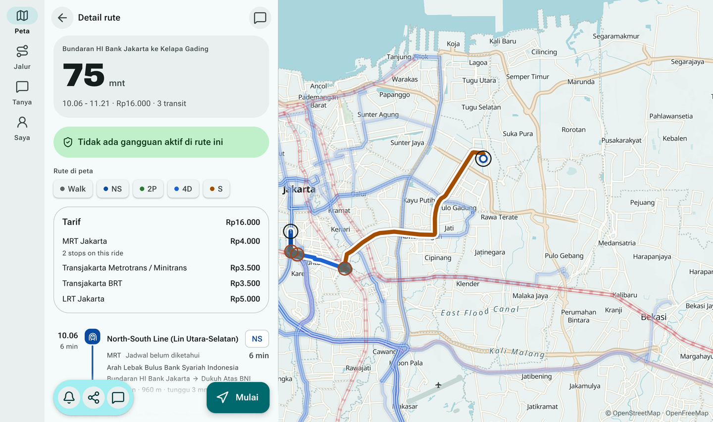
  </picture>
</p>

<p align="center">
  <sub>Adapts automatically to GitHub Light &amp; Dark mode · <a href="docs/images/daily-route.mp4">Watch full mobile tour (MP4)</a></sub>
</p>

---

Daily Route answers one question for commuters in Greater Jakarta: **how do I get from A to B right now, and is the way still open?** It unifies **7 transit modes** — **KRL Jabodetabek**, **MRT Jakarta**, **LRT Jakarta**, **LRT Jabodebek**, **Transjakarta BRT**, **Non-BRT** (Metrotrans / Royaltrans / Minitrans), and **Mikrotrans** — on one deterministic graph and one live map.

Two halves share the exact same source of truth:
- A **deterministic A\* route planner** over a road-snapped station graph (`256` lines, `5,715` stations, `101` hubs, `801` JPO footbridges) that never guesses.
- An **agentic commuter assistant** (**Tanya Daily**, powered by [Anvia](https://github.com/anvia-hq/anvia)) that calls the same planner through read-only tools, checks verified operator notices, and returns grounded semantic cards.

> [!NOTE]
> **The graph is always the truth.** There is no public GTFS-Realtime feed for Greater Jakarta operators, so every departure in the interface is clearly labelled as schedule-based (*"Berdasarkan jadwal, bukan kedatangan live"*). Neither the planner nor the assistant ever invents a station ID, coordinate, fare, or live ETA.

---

## Motion & Interactive Demo

Built with Material 3 Expressive spring physics (`linear()` spatial & effects curves), morphing container corners, and live HCT dynamic palettes:

<table>
  <tr>
    <td align="center" width="50%">
      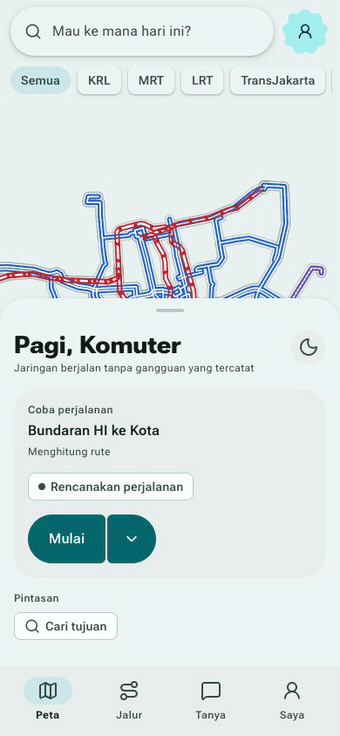<br><br>
      <strong>End-to-End Commuter Flow</strong><br>
      <sub>Live mode-filter map dimming → Search → Route comparison (<code>Tercepat</code> / <code>Termurah</code> / <code>Sedikit transit</code>) → Floating Vibrant Toolbar + Extended FAB → Live Trip wavy progress.</sub>
    </td>
    <td align="center" width="50%">
      <br><br>
      <strong>6 Live M3E Seeds &amp; HCT Dark Mode</strong><br>
      <sub>Layered expressive avatar, 4-tile Bento Grid, instant morphing across all 6 seed palettes (<code>Teal</code>, <code>Wall</code>, <code>Coral</code>, <code>Blue</code>, <code>Plum</code>, <code>Olive</code>), and Light ↔ Dark transitions.</sub>
    </td>
  </tr>
</table>

<p align="center">
  <a href="docs/images/daily-route.mp4"><strong>▶ Watch the full combined H.264 walkthrough (33s MP4)</strong></a>
</p>

---

## Screen Gallery

### Core Journey & Network

<table>
  <tr>
    <td align="center" width="25%">
      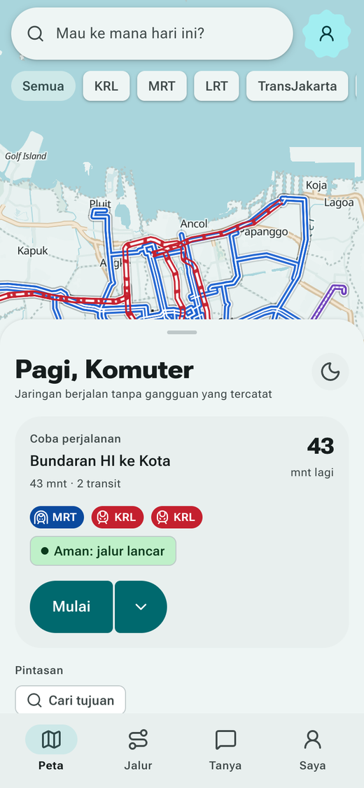<br>
      <strong>Beranda Peta</strong><br>
      <sub>Floating search, mode chips &amp; quick split-button start</sub>
    </td>
    <td align="center" width="25%">
      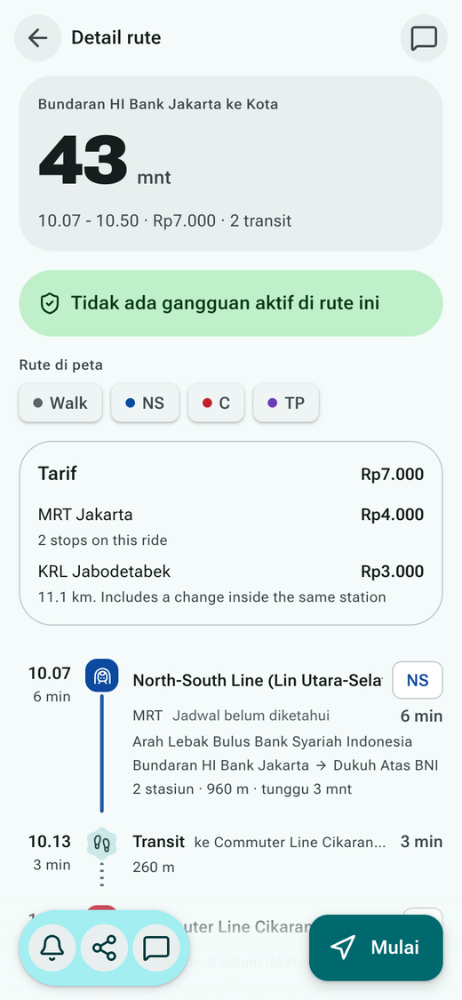<br>
      <strong>Detail Rute</strong><br>
      <sub>Fare breakdown, rail timeline &amp; Floating Vibrant Toolbar</sub>
    </td>
    <td align="center" width="25%">
      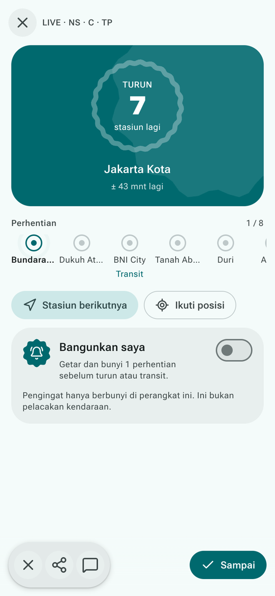<br>
      <strong>Perjalanan Live</strong><br>
      <sub><code>M3CircularWavyProgress</code> &amp; wake-before-alight alert</sub>
    </td>
    <td align="center" width="25%">
      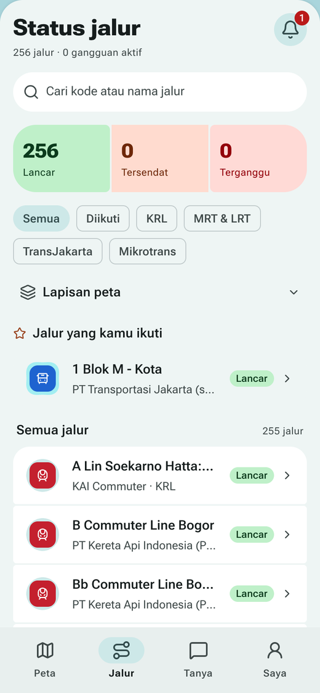<br>
      <strong>Status Jalur</strong><br>
      <sub>256 lines, followed shortcuts &amp; schedule-based stops</sub>
    </td>
  </tr>
</table>

### Assistant, Personalization & Onboarding

<table>
  <tr>
    <td align="center" width="25%">
      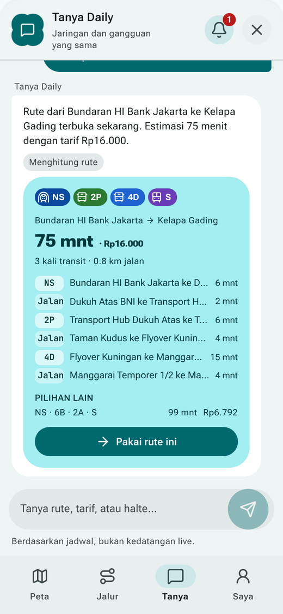<br>
      <strong>Tanya Daily</strong><br>
      <sub>Graph-grounded SSE semantic journey &amp; stop cards</sub>
    </td>
    <td align="center" width="25%">
      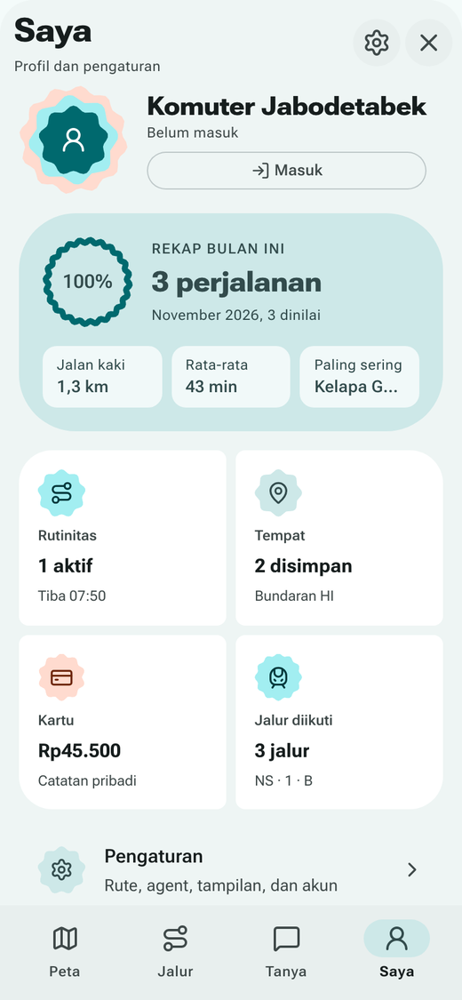<br>
      <strong>Saya &amp; Bento Grid</strong><br>
      <sub>Honest monthly recap, routines, places &amp; card ledger</sub>
    </td>
    <td align="center" width="25%">
      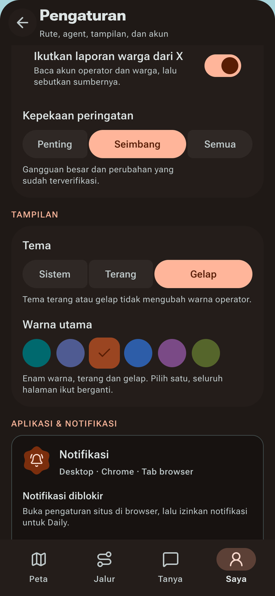<br>
      <strong>Pengaturan (Dark + Coral)</strong><br>
      <sub>Route priority, 6 live seed swatches &amp; PWA alerts</sub>
    </td>
    <td align="center" width="25%">
      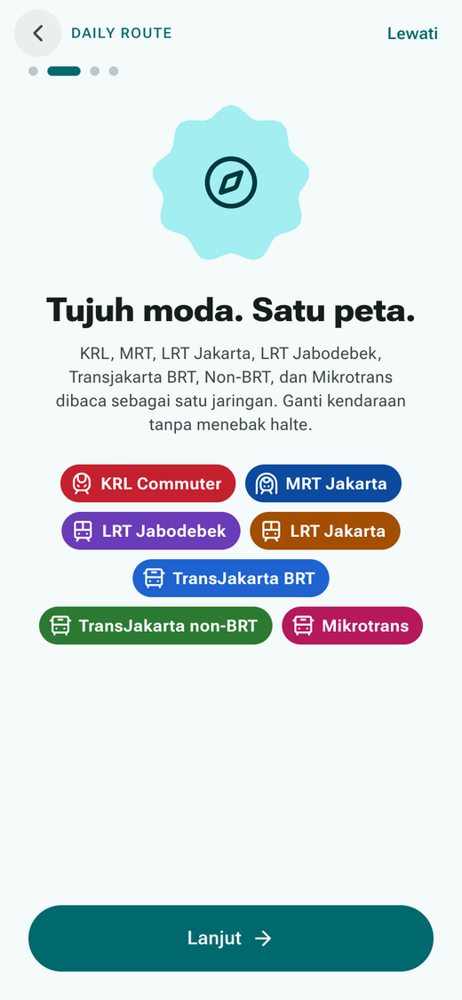<br>
      <strong>Onboarding</strong><br>
      <sub>7-step tour &amp; setup at <code>/onboarding</code></sub>
    </td>
  </tr>
</table>

---

## Features

| Area | Highlights |
| --- | --- |
| **Deterministic Multi-Modal Planner** | A\* search combining travel time, walking distance, waiting time (half median scheduled headway), and transfers across all 7 Jabodetabek systems. Road-snapped OSM/GTFS geometry cut cleanly at each platform, JPO footbridge access scoring, gate vs. tap-on-vehicle fare rules, silent late-night walk penalty (`22:00–05:00 WIB`), and automatic rerouting around active closures or temporary diversion patterns. |
| **Live Disruption Pipeline** | X API v2 filtered stream (`from:<operator> -is:retweet`) backed by a durable Postgres `FOR UPDATE SKIP LOCKED` queue, Jev screening, graph-grounded `NoticeGrounder`, platform & direction scoping, evidence-backed `NoticeReviewAgent`, and temporary service overlays. |
| **Tanya Daily (AI Assistant)** | [Anvia](https://github.com/anvia-hq/anvia) read-only tool agent streaming structured SSE `card`, `tool`, `actions`, and `delta` events. Cards are produced strictly from tool outputs — never regex-parsed from prose. Supports current-location routing without leaking coordinates to the model. |
| **Personal Commuter Surface (`Saya`)** | Optional email/password account (`HttpOnly` session cookies) with full local-first guest mode. Includes daily routines CRUD, up to 16 named places + current-location reverse lookup, honest transit-card ledger (Web NFC detection + clearly labelled simulation + manual log), followed lines, and monthly trip recaps computed strictly from finished trips. |
| **Overture Places & JPO Registry** | Local extract of `272,727` Jabodetabek places (Overture Maps) queried before any external geocoder, plus `801` pedestrian bridges merged from Dinas Bina Marga DKI Jakarta and OpenStreetMap (`"Via JPO ..."` walk hints). |

---

## Material 3 Expressive & PWA

Daily Route's front end (`apps/web`) is built mobile-first around Google's **Material 3 Expressive** specification and ships as a cross-platform **Progressive Web App**:

- **Expressive Tokens & Primitives**: 17 typed M3E primitives in [`apps/web/src/components/m3e/`](apps/web/src/components/m3e/index.ts) (`M3Shape`, `M3SplitButton`, `M3ConnectedButtonGroup`, `M3FloatingToolbar`, `M3NavigationBar`, `M3NavigationRail`, `M3BottomSheet`, `M3CircularWavyProgress`, `M3LinearWavyProgress`, `M3LoadingIndicator`, `M3ExpressiveList`, `M3Slider`, `M3Switch`, `M3Chip`, `M3Snackbar`, `M3Card`, `M3ModeBadge`).
- **Dynamic Color & Harmonized Basemap**: 6 live HCT seed palettes (`Teal #00696E`, `Wall #4F5B92`, `Coral #9A4521`, `Blue #2D5DA8`, `Plum #7A4A86`, `Olive #55652B`) in both **Light** and **HCT Dark** modes with zero FOUC bootstrap and synchronized `<meta name="theme-color">` and MapLibre GL basemap styling — while preserving official operator colors.
- **22 Shapes & 9 Spring Curves**: Exact 64-point `clip-path` polygons (`cookie4`, `cookie9`, `cookie12`, `sunny`, `softburst`, etc.) and CSS `linear()` spatial/effects springs respecting `prefers-reduced-motion`.
- **Android Chrome & iOS Safari PWA**:
  - Dedicated `any` & `maskable` icons + opaque `apple-touch-icon-180.png`, 3 app shortcuts (`Cari rute`, `Status jalur`, `Kotak masuk`) in [`manifest.webmanifest`](apps/web/public/manifest.webmanifest).
  - Service worker ([`sw.js`](apps/web/public/sw.js)) with precached shell, SWR static assets, offline cache for read-only transit endpoints, and strict pass-through for SSE chat and `/api/account/*`.
  - Native Android `beforeinstallprompt` sheet + guided iOS *Share → Add to Home Screen* sheet + notification capability guard for iOS standalone web apps.

---

## Quick Start

### Prerequisites

- **Node.js** `>= 22.16`
- **pnpm** `10.30.3`
- **Docker** (for PostgreSQL 16 + `pgvector`)

### Run Locally

```bash
git clone https://github.com/iqbalShafiq/daily-route.git
cd daily-route
pnpm install
cp .env.example .env
pnpm infra:up          # starts Postgres 16 + pgvector on port 5433
pnpm db:migrate        # applies Drizzle migrations
pnpm db:seed           # loads data/transit-network.json and data/line-patterns.json
pnpm data:embed        # optional: computes station embeddings
pnpm dev               # starts API (:3011), worker (:4012), and web (:3010)
```

Open **[http://localhost:3010](http://localhost:3010)** (or **[http://localhost:3010/onboarding](http://localhost:3010/onboarding)** to preview the 7-step onboarding flow).

| Service | URL |
| --- | --- |
| Web (M3E PWA) | <http://localhost:3010> |
| API (Express) | <http://localhost:3011> |
| Worker health | <http://localhost:4012/health> |

> [!TIP]
> The route planner, live map, line/station browser, and PWA features work **without any AI or X API keys**. There is exactly **one** `.env` at the repository root — all keys stay strictly on the server (no `VITE_` secrets).

<details>
<summary><strong>Environment variables &amp; optional integrations</strong></summary>

| Variable | What it unlocks |
| --- | --- |
| `DATABASE_URL` | Postgres 16 + `pgvector` (pre-configured for `docker-compose.yml` on port `5433`). |
| `AGENT_BASE_URL`, `AGENT_API_KEY`, `AGENT_MODEL` | Chat assistant and disruption classifier via any OpenAI-compatible endpoint. |
| `JEV_MODEL` | Screening model behind Jev (defaults to `typesafe/jev-1.14`). |
| `EMBEDDINGS_BASE_URL`, `EMBEDDINGS_API_KEY`, `EMBEDDINGS_MODEL` | 768-dim semantic place lookup. Falls back cleanly to lexical/exact search when omitted. |
| `TAVILY_API_KEY` | On-demand `search_news` tool for the assistant and notice review. |
| `GOOGLE_MAPS_API_KEY` | Optional fallback geocoder when local Overture places return fewer than 3 matches (otherwise Photon/Nominatim). |
| `X_BEARER_TOKEN` | X API v2 filtered stream for official operator disruption notices. |
| `LANGFUSE_BASE_URL`, `LANGFUSE_PUBLIC_KEY`, `LANGFUSE_SECRET_KEY` | Optional tracing for agent runs and evaluations. |
| `CLASSIFY_BUDGET_MS`, `CLASSIFY_LEASE_MS`, `CLASSIFY_CONCURRENCY`, `NOTICE_SWEEP_LIMIT` | Tuning knobs for the durable classification queue and review sweeps. |

</details>

---

## Architecture

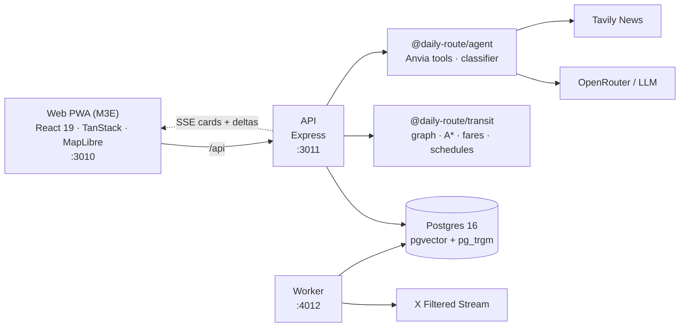

### Monorepo Layout

| Path | Responsibility |
| --- | --- |
| [`apps/web`](apps/web) | Mobile-first Material 3 Expressive PWA — React 19, Vite, TanStack Router & Query, Tailwind CSS 4, MapLibre GL. |
| [`apps/api`](apps/api) | Express HTTP API: transit reads, line/station details, route planning, place lookup, accounts, and SSE agent chat. |
| [`apps/worker`](apps/worker) | Background disruption monitor: X filtered stream, durable Postgres queue, notice grounding, review, and temporary services. |
| [`packages/transit`](packages/transit) | Pure framework-free TypeScript domain: station graph, A\* planner, road geometry, fares, service windows, JPO scoring, habits. |
| [`packages/semantic`](packages/semantic) | Embedding providers and multi-channel place resolver. |
| [`packages/agent`](packages/agent) | Anvia assistant, read-only tools, classifier, monitor, X and Tavily clients. |
| [`packages/ingest`](packages/ingest) | OpenStreetMap extraction, Transjakarta GTFS merge, admin enrichment, Overture places, and JPO registry builder. |
| [`packages/db`](packages/db) | Drizzle schema, queries, migrations, seed, and non-destructive snapshot sync. |
| [`packages/env`](packages/env) | Single validated environment schema. |
| [`packages/config`](packages/config) | Shared TypeScript and ESLint configuration. |

---

## Data Pipeline

The committed snapshot (`data/transit-network.json` & `data/line-patterns.json`) currently holds **256 lines, 5,715 stations, 16,520 stop sequences, 101 interchange groups, 420 directed geometries, 34 GTFS-derived patterns, 272,727 Overture places, and 801 JPO footbridges**.

<details>
<summary><strong>Network merge rules, places extract, JPO registry &amp; rebuild commands</strong></summary>

### Merge Priority
1. Curated research reports (`research/data/*.json`) own the official **line name and stop order**.
2. **OpenStreetMap** (ODbL) owns stop **coordinates**, directed road geometries, and missing stops.
3. OSM relation names win for **service class** (e.g. Metrotrans vs. Minitrans).
4. Unopened/planned lines never become routable (`isPlanned()`).
5. Cross-system stops with matching names (`<= 400 m`) or curated interchange aliases (`<= 1.2 km`) merge into walkable hubs capped at `600 m` diameter.

### Rebuilding Snapshots (in order)

```bash
pnpm data:ingest          # rebuild snapshot from OpenStreetMap + research
pnpm data:gtfs            # fill GTFS-only routes, shapes & scheduled service windows
pnpm data:enrich          # attach kelurahan / kecamatan / kota from BIG boundaries
pnpm db:sync              # sync snapshot to Postgres without clearing notices
pnpm data:embed           # recompute 768-dim station embeddings
pnpm data:jpo             # rebuild Dinas Bina Marga + OSM JPO registry
pnpm data:places          # extract Jabodetabek places from Overture Maps (needs DuckDB CLI)
pnpm db:places            # load Overture extract into map_places
```

On a fresh database, run `pnpm db:seed` instead of `pnpm db:sync`, followed once by `pnpm db:places`.

</details>

<details>
<summary><strong>Planner internals, notice pipeline &amp; assistant guardrails</strong></summary>

### Deterministic Planner (`packages/transit`)
- **Path geometry**: Ride legs slice the stored OSM/GTFS polyline at the exact foot of boarding and alighting stops; walk legs use the pedestrian router and never fall back to invented straight lines.
- **Schedules (`serviceAt`)**: Filters active lines by direction and departure instant; half the median headway is added to the A\* cost.
- **Silent night rule**: Departures between `22:00` and `05:00 WIB` apply a walking penalty to favour safer transfers without exposing a false "safety guarantee" toggle.
- **Disruption awareness**: `routeIsClear` drops routes touching closed stops/lines; `withDiversions()` applies sourced temporary diversion spans while keeping line identity and fare.

### Disruption Pipeline (`apps/worker` + `packages/agent`)
1. Single X v2 filtered stream (`from:<account> -is:retweet`) with 8-hour bounded catch-up on reconnect.
2. Durable Postgres queue (`FOR UPDATE SKIP LOCKED`, backoff retries, `needs_review` after 8 failures).
3. **Jev** screens text items → tool-free **classifier** extracts names → **resolver / `NoticeGrounder`** validates every ID against the live graph → platform/direction scoping → evidence-backed `NoticeReviewAgent` at `review_at`.

### Assistant Guardrails (`Tanya Daily`)
- Every tool (`find_line`, `list_line_stops`, `find_street`, `stops_on_street`, `resolve_place`, `plan_journey`, `get_station`, `list_active_disruptions`, `find_toll_routes`, `find_jpo`, `list_notice_history`, `search_news`) is read-only.
- Missing credentials omit the tool rather than inventing data; every semantic chat card comes directly from tool results.

</details>

---

## Development & Verification

```bash
pnpm dev                  # API (:3011), worker (:4012), and web (:3010)
pnpm typecheck            # tsc --noEmit across all workspaces
pnpm lint                 # ESLint across all workspaces
pnpm test                 # unit & integration tests (serial against Postgres)
pnpm build                # production builds for every package
pnpm --filter @daily-route/web exec playwright test e2e/m3e-pwa.spec.ts
                          # stubbed M3E + PWA E2E suite (desktop & Pixel 5, no LLM/X keys needed)
pnpm test:e2e             # full Playwright suite against live API + Postgres
```

Visual & model evaluation tools:

```bash
python3 research/tools/ux-visual/typography_check.py
python3 research/tools/ux-visual/layout_check.py
pnpm eval:notices         # judge notice pipeline against labelled cases
pnpm eval:current-place   # Anvia eval of current-place grounding
pnpm backtest:notices     # replay stored operator posts through the pipeline
```

---

## Contributing

Contributions, bug reports, and pull requests are welcome!

1. Read [`AGENTS.md`](AGENTS.md) and [`DESIGN.md`](DESIGN.md) first — they define the architecture boundaries, M3E rules, and data honesty invariants.
2. Branch from `main`, keep changes focused, and use [Conventional Commits](https://www.conventionalcommits.org/).
3. Run `pnpm typecheck`, `pnpm lint`, `pnpm test`, and relevant Playwright/visual checks before opening a PR.

---

## License & Attribution

Released under the [MIT License](LICENSE).

- Transit network & footbridge geometry: © [OpenStreetMap](https://www.openstreetmap.org/copyright) contributors (ODbL 1.0) & Transjakarta GTFS
- Basemap vector tiles: [OpenFreeMap](https://openfreemap.org)
- Places extract: [Overture Maps Foundation](https://overturemaps.org) (CDLA Permissive 2.0 / Apache 2.0)
- Official DKI Jakarta JPO registry: Dinas Bina Marga DKI Jakarta (Jakarta Satu)
